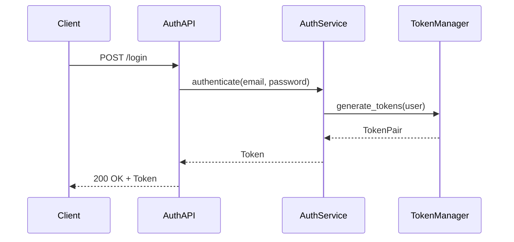
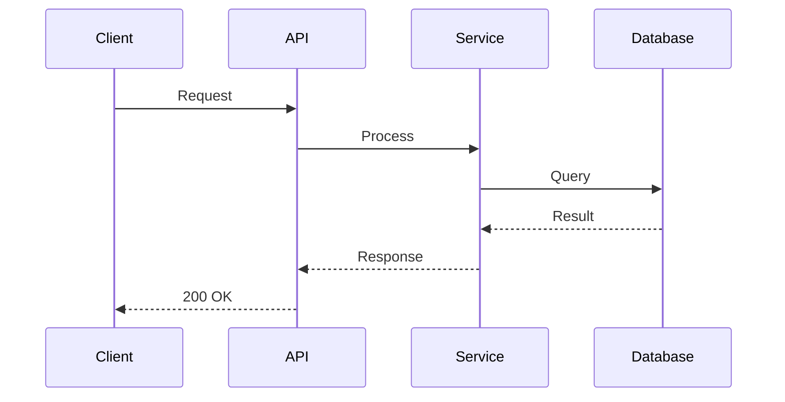
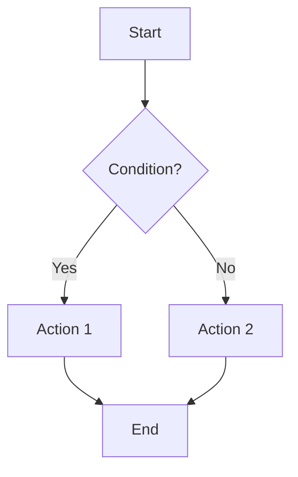
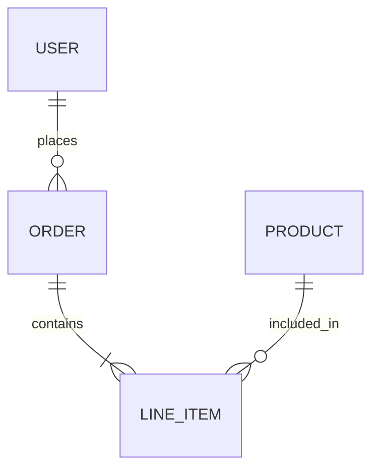
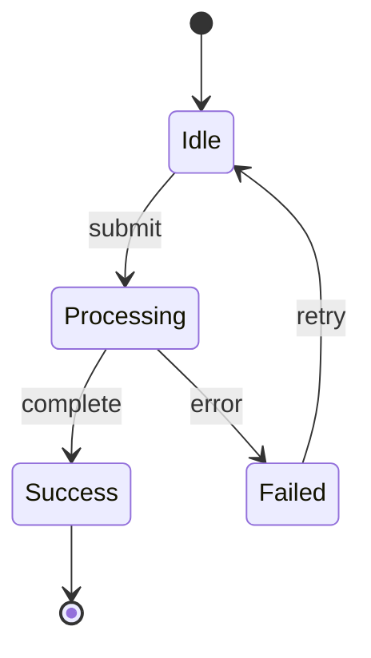
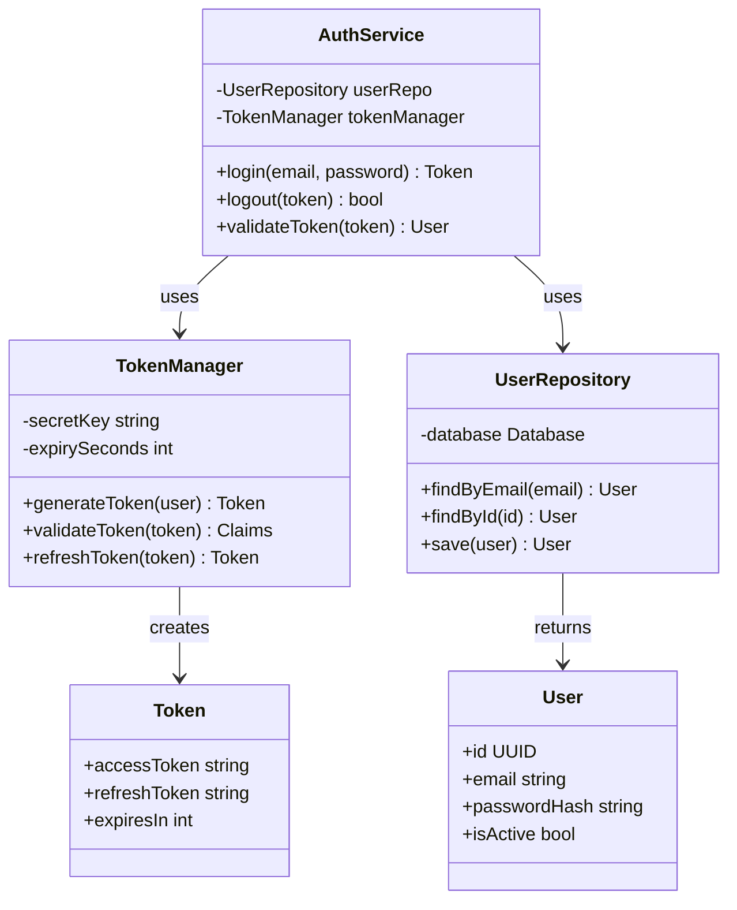

# Technical Design Templates Reference

This document contains detailed templates and examples for creating technical design documents.

The generic authentication examples below illustrate interfaces/data/diagrams,
not mandatory scope or permission to add JWT/refresh/rate limiting. Instantiate
only approved requirements. Replace every placeholder with actual project-root
paths; do not copy nonexistent sample dependencies into a delivered design.
Component names below describe planned means, not proof of implementation.

---

## Document Template

```markdown
# Technical Design: {Feature Title}

> Feature ID: FEATURE-XXX | Version: v1.0 | Last Updated: YYYY-MM-DD

---

## Part 1: Agent-Facing Summary

> **Purpose:** Quick reference for AI agents navigating large projects.
> **📌 AI Coders:** Focus on this section for implementation context.

### Scope & Boundaries

{One authoritative feature, actual program_type/tech_stack, constraints/non-goals,
source specification and approved delta; preserve existing language/IDs.}

### Outcome / Goal Frame

| Goal ID | Parent / Source | Stakeholder | Desired Observable Outcome | Contribution / Selection | Success Evidence | Constraints / Non-goals | AC Links | Outcome State |
| --- | --- | --- | --- | --- | --- | --- | --- | --- |
| {existing FR/US ID} | {exact parent/source anchor; inferred only for legacy explicit so-that} | {actual stakeholder} | {source outcome} | {enabling rationale; all-required or selected alternative} | {qualitative scenario or justified measure} | {approved constraints} | {stable scoped AC IDs} | {not measured or cited actual observation} |

### Design Options and Tradeoffs

| Means | Selection | Goal / AC / Constraint Rationale |
| --- | --- | --- |
| {component/pattern} | {selected/rejected/deferred} | {why this serves approved outcome; alternatives are not scope} |

### Key Components Implemented

| Component | Responsibility | Scope/Impact | Tags |
|-----------|----------------|--------------|------|
| `AuthService` | User authentication | Login flow across apps | #auth #security #core |
| `TokenManager` | JWT generation/validation | Session management | #auth #jwt |

### Dependencies

| Dependency | Source | Design Link | Usage Description |
|------------|--------|-------------|-------------------|
| `UserRepository` | {owning feature} | [dependency design]({dependency_design_path}) | Query user records only if required by specification |
| `ConfigManager` | Foundation | [configuration design]({configuration_design_path}) | Load approved authentication settings |

### Major Flow

1. Client submits credentials → AuthService validates → TokenManager generates JWT → Response returned
2. Subsequent requests include JWT → TokenManager validates → Access granted/denied

### Usage Example

```python
# Authentication flow
auth = AuthService()
token = auth.login(email="user@test.com", password="secure")

# Using the token
api.set_auth_header(token.access_token)
response = api.get("/protected-resource")
```

### Tool Capability Summary

{Actual type/stack, technical_design configuration and _extra_instruction;
enabled/matched/excluded tools and consulted relevant practices. Consultation
only, not execution or binding availability-driven document format.}

---

## Part 2: Implementation Guide

> **Purpose:** Human-readable details for developers.
> **📌 Emphasis on visual diagrams for comprehension.

### Workflow Diagram



### [Data Models / API Specs / CLI Commands - adapt to implementation type]

(Content varies based on whether this is API, CLI, frontend, etc.)

### Algorithms and State Transitions

{Inputs, invariants, ordered decisions/transforms, outputs, concurrency/failure
handling and complexity only where relevant; justified by scoped acceptance.}

### Implementation Steps

1. **{Layer}:** [Tasks]
2. **{Layer}:** [Tasks]

{Use actual source_code_path/test_code_path, existing interfaces and module sizes;
extract new functionality if current + new exceeds 800 lines. No code execution.}

### Edge Cases & Error Handling

| Scenario | Expected Behavior |
|----------|-------------------|
| Invalid password | 401 Unauthorized |
| Rate limit exceeded | 429 Too Many Requests |

### Goal / Acceptance / Design / Validation Coverage

| Source / Parent Goal | Story / Subgoal | AC ID | Component / Flow | Interface / Data / Algorithm | Planned Validation | Delivery State | Outcome State |
| --- | --- | --- | --- | --- | --- | --- | --- |
| {authoritative source/parent} | {existing story/subgoal} | {stable leaf AC} | {justified selected means} | {specific contract section} | {test type, concrete input/result and source/test path} | {planned; actual revision-bound delivery only if evidenced} | {not measured or cited observation} |

### Outcome Scenario and Evidence Gaps

{Stakeholder/context, observable conditions and result from authoritative goal;
known evidence/owner or unavailable observation. No invented KPI or claim that
design/test approval proves stakeholder benefit.}

### Test Plan

{Map every scoped AC to concrete unit/integration/UI/API checks and outcome
scenario. Preserve specification test types. Include edge/error/regression
checks, actual test paths, planned commands and inputs/results; no fake pass.}

### Mockup-to-Component Mapping

{For frontend/fullstack, open every current provided/linked mockup and map visual
elements/layout/spacing/colors/states/events/accessibility/responsiveness to
components and acceptance. N/A with scope rationale otherwise. Mockup is visual
source of truth within approved specification scope; resolve conflicts.}

### Security, Tracing and Observability

{Existing infrastructure and INFO/DEBUG boundaries, sensitive parameter/log
redaction, error handling without secrets, opt-in/config behavior and planned
checks; N/A rationale when inapplicable. No instrumentation during design.}

### Delta and Evidence Invalidation

{Authorized CR/parent/means delta, affected goals/AC/contracts/dependencies,
affected design/test/outcome evidence and exact downstream reruns; preserve
unaffected IDs/bytes/history/evidence. No-op resume does not rewrite history.}

---

## Design Change Log

| Date | Phase | Change Summary |
|------|-------|----------------|
| {YYYY-MM-DD} | Initial Design | Initial technical design created. |
```

---

## Version History Format

Add at top of document after header when design evolves:

```markdown
## Version History

| Version | Date | Description |
|---------|------|-------------|
| v2.0 | 01-22-2026 | Major upgrade: xterm.js, session persistence, split-pane |
| v1.0 | 01-18-2026 | Initial design with VanillaTerminal |
```

---

## Part 1: Agent-Facing Summary Guidelines

### Purpose
Enable AI agents to quickly understand and reference designs across large projects.

> **📌 Note for AI Coders:** Read both parts before implementation. Part 1 summarizes intent and means; Part 2 supplies the required detailed contracts and validation plan, independent of tool availability.

### Required Elements

| Element | Description |
|---------|-------------|
| Key Components | What modules/classes/services were created or modified |
| Scope & Boundaries | What this design covers and what it doesn't |
| Dependencies | Components from other features/foundation this feature relies on |
| Major Flow | High-level description of how components interact |
| Usage Example | Code snippet showing how to use the implemented feature |

### Dependency Table Format

| Dependency | Source | Design Link | Usage Description (≤50 words) |
|------------|--------|-------------|-------------------------------|
| `AuthService` | {owning feature} | [dependency design]({dependency_design_path}) | Used only if approved authentication scope requires it |
| `DatabaseManager` | Foundation | [database design]({database_design_path}) | Reuse established connection pooling/query contract |

### Format Guidelines

- Use tables for component listings (Component | Responsibility | Scope/Impact | Tags)
- Use dependency table for cross-feature/foundation dependencies
- Tags enable semantic search across project designs
- Keep concise - this is a reference summary, not documentation

---

## Part 2: Implementation Guide Guidelines

### Purpose
Detailed guide for developers to understand and implement the design.

> **📌 Note:** This section emphasizes visual diagrams and step-by-step guidance for human comprehension.

### Sections (Include as needed)

| Section | When to Include |
|---------|-----------------|
| Workflow Diagrams | REQUIRED for complex flows |
| Class Diagram | RECOMMENDED for OOP designs |
| Data Models | Schema definitions, type structures |
| API/Interface Specs | Endpoints, CLI commands, function signatures |
| Implementation Steps | Ordered tasks to build the feature |
| Edge Cases | Error handling, boundary conditions |
| Algorithms and Test Plan | Required scoped decisions/state transitions and AC-mapped planned checks |
| Goal Coverage and Outcome Scenario | Required source/parent/story/AC-to-means validation mapping and honest evidence gaps |
| Security, Tracing and Observability | Applicable existing patterns/redaction/opt-in/test plan, or explicit N/A |

### Format Guidelines

- **Prioritize visualization** - Use Mermaid diagrams liberally for:
  - Sequence diagrams for API/service interactions
  - Flowcharts for decision logic
  - Entity-relationship diagrams for data models
  - State diagrams for stateful components

---

## Implementation Type Adaptations

### API-Based Features

Focus on:
- Endpoints, request/response schemas
- Authentication requirements
- Rate limiting, pagination
- Sequence diagrams for complex flows

### CLI-Based Features

Focus on:
- Commands, flags, arguments
- Output formats
- Exit codes
- Help text structure

### Frontend Features

Focus on:
- Component architecture
- State management
- User interaction flows
- Wireframes/mockup references

### Backend/Service Features

Focus on:
- Service interfaces
- Data flow diagrams
- Integration points
- Error handling strategies

---

## Mockup Reference Guidelines

### When to Use Mockup List

```
IF Mockup List != N/A AND Technical Scope in specification.md includes [Frontend] OR [Full Stack]:
  1. OPEN and analyze the Mockup List file(s)
  2. Extract UI requirements from mockup:
     - Component hierarchy and structure
     - State management requirements
     - Event handlers and user interactions
     - CSS/styling approach
     - Layout structure, spacing, colors, and visual details
  3. Design frontend components based on mockup
  4. Include mockup-derived requirements in Part 2 Implementation Guide
  5. Reference mockup filenames in design decisions
  6. CRITICAL: Treat mockup as the source of truth for visual design.
     The technical design MUST faithfully translate mockup visuals into
     component specifications (layout, structure, styling) so that
     Code Implementation reproduces the mockup precisely.

ELSE IF Mockup List == N/A AND specification.md has "Linked Mockups" section:
  1. MUST review "Linked Mockups" section in specification.md
  2. Open and analyze each linked mockup file
  3. Follow same extraction process as above

ELSE (Backend/API Only/Database/Infrastructure OR no mockups available):
  - Skip mockup reference
  - Focus on service architecture, data models, APIs
```

### UI Design Document Additions

When Technical Scope includes frontend, Part 2 SHOULD include:
- UI Component breakdown
- State management strategy
- Mockup-to-component mapping

---

## Design Change Log Format

When the technical design needs to be updated (during implementation, bug fix, or feature extension), add an entry:

| Date | Phase | Change Summary |
|------|-------|----------------|
| YYYY-MM-DD | {Phase where change occurred} | {Summary in ~100 words: what changed, why it changed, impact on components} |

**Valid Phases:** Technical Design, Test Generation, Code Implementation, Bug Fix, Feature Extension

---

## API Design Example

```markdown
### API Specification

#### POST /api/v1/auth/login

**Request:**
```json
{
  "email": "user@example.com",
  "password": "secure123"
}
```

**Response (200):**
```json
{
  "access_token": "eyJ...",
  "refresh_token": "eyJ...",
  "expires_in": 3600
}
```

**Errors:**
| Status | Code | Description |
|--------|------|-------------|
| 401 | INVALID_CREDENTIALS | Email or password incorrect |
| 429 | RATE_LIMITED | Too many login attempts |
```

---

## Data Model Example

```markdown
### User Entity

```python
@dataclass
class User:
    id: UUID
    email: str
    password_hash: str
    created_at: datetime
    updated_at: datetime
    is_active: bool = True
```

### Database Schema

```sql
CREATE TABLE users (
    id UUID PRIMARY KEY DEFAULT gen_random_uuid(),
    email VARCHAR(255) UNIQUE NOT NULL,
    password_hash VARCHAR(255) NOT NULL,
    created_at TIMESTAMP DEFAULT NOW(),
    updated_at TIMESTAMP DEFAULT NOW(),
    is_active BOOLEAN DEFAULT TRUE
);
```
```

---

## Mermaid Diagram Examples

### Sequence Diagram



### Flowchart



### Entity Relationship



### State Diagram



### Class Diagram


