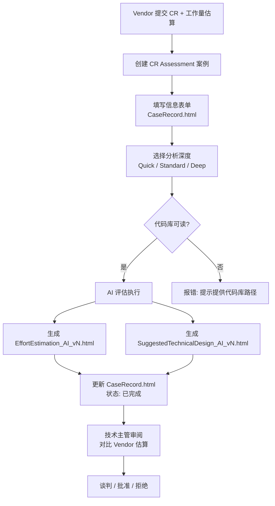
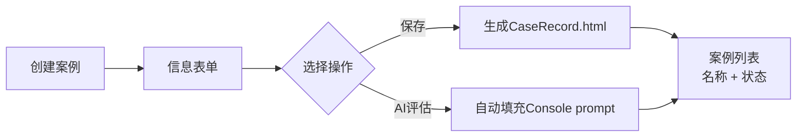
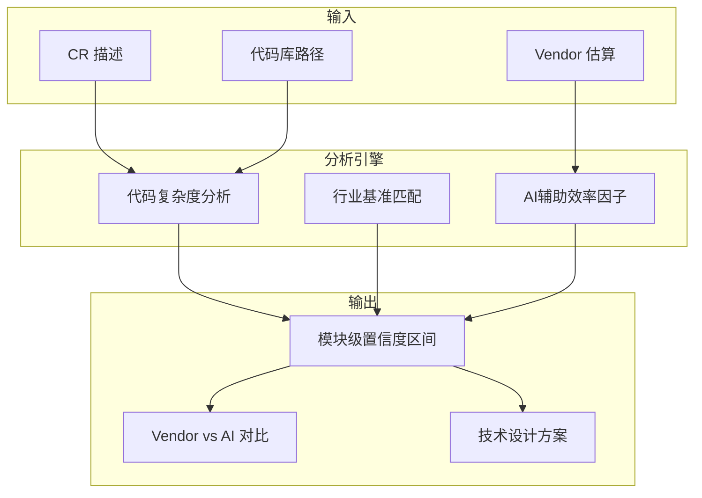
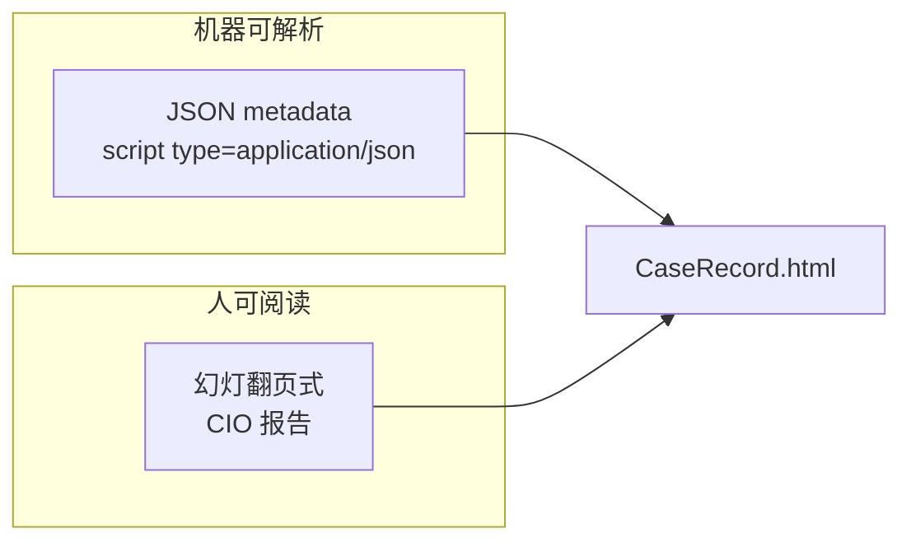

# Idea Summary

> Idea ID: IDEA-001
> Folder: Draft Idea - 07202026 121023
> Version: v1
> Created: 2026-07-20
> Status: Refined

## Overview

CR Assessment AI Court — 一个 AI 驱动的供应商变更请求（Change Request）工作量评估模块，集成到 X-IPE 平台中。当供应商提交 CR 及工作量估算后，技术团队创建评估案例，AI 基于代码复杂度分析和行业基准，独立生成带置信度区间的工作量估算和技术方案，为谈判提供数据支撑，保护公司合法权益。

## Problem Statement

供应商提交的变更请求工作量估算往往是一个黑箱：
- 技术团队缺乏客观依据来验证 Vendor 的报价是否合理
- 传统人工评估耗时且标准不一
- AI 时代开发效率提升，Vendor 仍按传统人工方式估算，造成偏差
- 缺乏规范的评估流程和报告体系，难以沉淀为组织知识

## Target Users

| 角色 | 职责 | 使用场景 |
|------|------|---------|
| **项目经理** | 整体成本控制、谈判策略 | 创建案例、审阅 AI 报告、对比 Vendor 估算 |
| **技术主管** | 技术可行性评估、复杂度分析 | 配置代码库路径、审阅技术设计方案 |

## Proposed Solution

### 核心流程



### 系统架构

```architecture-dsl
layer "CR Assessment View" {
  rows 1
  module "Case List Panel" {
    cols 4
    component "案例列表 (名称 + 状态)"
  }
  module "Detail Panel" {
    cols 8
    component "信息表单 / 文件内嵌预览"
  }
}

layer "Case Storage" {
  rows 1
  module "cr-cases/{case-name}/" {
    cols 12
    component "CaseRecord.html (元数据 + CIO报告)"
    component "EffortEstimation_AI_vN.html (AI估算)"
    component "SuggestedTechnicalDesign_AI_vN.html (技术方案)"
    component "EffortEstimation_Vendor (Vendor估算)"
    component "SupportingDocuments/ (补充材料)"
  }
}

layer "AI Evaluation Engine" {
  rows 1
  module "x-ipe-task-based-evaluate-change-request-efforts" {
    cols 12
    component "Quick (目标模块分析)"
    component "Standard (影响范围分析)"
    component "Deep (全量基线分析)"
    component "Industry Benchmarks (内置基准)"
    component "Output Templates (内置HTML模板)"
  }
}

layer "X-IPE Console" {
  rows 1
  module "copilot-prompt.json" {
    cols 12
    component "CR评估prompt入口"
  }
}
```

## Key Features

### 1. 案例管理



- 创建/查看 CR 评估案例
- 案例状态流转：已创建 → 评估中 → 已完成
- 状态保存在 `CaseRecord.html` 的 metadata 中，技能完成后通过 Python 脚本更新
- 案例存放路径：`x-ipe-docs/cr-cases/{case-name}/`

### 2. Information Form

收集以下信息：
- **Case Name** — 案例名称
- **CR Description** — 文本输入或上传文件（保留原始格式），嵌入 CaseRecord.html
- **Codebase Path** — 文件系统浏览器选择代码库根目录
- **Supporting Documents** — 上传多种格式文件（Vendor 提供）
- **EffortEstimation_Vendor** — 上传 Vendor 工作量估算文件
- **Comments** — 注释文本
- **Submit/Update Case** — 保存/更新案例
- **AI Estimation** — 下拉菜单选择分析深度后触发

### 3. AI 工作量评估



- **分析深度**（AI Estimation 按钮下拉菜单）：
  - **Quick** — 仅目标模块分析，快速产出
  - **Standard**（默认）— 影响范围分析，考虑依赖链
  - **Deep** — 全量基线分析，最全面
- **评估标准**：代码复杂度分析 + 行业基准，加权综合
- **输出形式**：切分模块，每个模块独立输出带置信度的区间估算
  - 示例：`模块A(前端): 3-5人天, 置信度90%`
- **AI 效率考量**：评估考虑 AI 辅助开发效率，Vendor 可能按传统方式估算，AI 给出优化路径
- **版本管理**：v1, v2... 旧文件保留，CaseRecord.html 链接到最新版本

### 4. CaseRecord.html



- **双重用途**：机器可解析的 JSON metadata + 专业 CIO 报告 UI
- **Metadata 结构**：案例名称、状态、创建时间、文件引用、版本号等
- **幻灯翻页式展示**（PPT 风格）：
  - 封面 → 案例概览 → Vendor vs AI 对比 → AI 评估详情 → 技术设计方案链接 → 附件清单
  - 页面结构根据案例内容动态生成
  - 键盘左右箭头/翻页按钮导航
- **模块可折叠/展开**，便于快速浏览

### 5. EffortEstimation_AI_vN.html

- AI 独立生成的工作量估算报告
- 模块级置信度区间展示
- Vendor vs AI 对比分析
- 行业基准引用透明化（展示基准来源和调整因子）
- 双向对称评估：既识别 Vendor 高估，也识别 Vendor 低估（风险提示）

### 6. SuggestedTechnicalDesign_AI_vN.html

- 完整技术设计方案，包含：
  - 架构设计（支持 Mermaid 插件展示设计图）
  - 模块变更清单 + 实现步骤
  - 数据库变更（如有）
  - API 变更（如有）
  - 测试策略建议
  - 风险评估
- 针对不同分析深度输出不同粒度

### 7. UI 布局

```
┌─────────────────────────────────────────────────────────┐
│  CR Assessment                                           │
├────────────────────────┬────────────────────────────────┤
│  Case List Panel       │  Detail Panel                  │
│                        │  (内嵌预览 / 编辑)             │
│  [案例名称]  ✅已完成  │                                │
│  [案例名称]  ⏳评估中  │  ┌─ Information Form ──┐       │
│  [案例名称]  📋已创建  │  │ Case Name: [___]    │       │
│                        │  │ CR Desc: [___]      │       │
│  [+ 新建案例]          │  │ Codebase: [选择...] │       │
│                        │  │ Files: [上传...]    │       │
│                        │  │ Comments: [___]     │       │
│                        │  │                     │       │
│                        │  │ [提交/更新] [AI评估▾] │       │
│                        │  └─────────────────────┘       │
└────────────────────────┴────────────────────────────────┘
```

### 8. Copilot Prompt 集成

遵循 X-IPE 现有模式，在 `copilot-prompt.json` 中添加 CR Assessment 入口：

```json
{
  "cr-assessment": {
    "prompts": [{
      "id": "evaluate-cr-effort",
      "icon": "bi-scale",
      "prompt-details": [
        {
          "language": "en",
          "label": "AI Estimation",
          "command": "evaluate change request effort for <case-folder> with evaluate-change-request-efforts skill --analysis-depth standard"
        }
      ]
    }]
  },
  "placeholder": {
    "case-folder": "Replaced with current case folder path"
  }
}
```

## Success Criteria

- [ ] 技术主管可以创建 CR 评估案例，填写信息表单
- [ ] 上传 Vendor 的 CR 描述和估算文件，选择代码库路径
- [ ] AI 在 3 种分析深度（Quick/Standard/Deep）下生成带置信度区间的估算报告
- [ ] 生成的 `EffortEstimation_AI_vN.html` 展示模块级对比
- [ ] 生成的 `SuggestedTechnicalDesign_AI_vN.html` 包含 Mermaid 架构图
- [ ] `CaseRecord.html` 以幻灯翻页式展示，支持键盘导航
- [ ] 案例状态自动流转（已创建 → 评估中 → 已完成）
- [ ] 版本管理生效（v1, v2 保留旧文件，CaseRecord 链接最新）
- [ ] 代码库不可读时，AI Estimation 按钮不可用并提示

## Constraints & Considerations

- **代码库访问**：评估必须基于可读的代码库路径，否则拒绝执行
- **与现有技能独立**：`x-ipe-task-based-evaluate-change-request-efforts` 完全独立于 `x-ipe-task-based-change-request`
- **行业基准**：技能内置，不依赖外部配置或服务
- **知识图谱回写**：当前版本不回写，预留接口供未来扩展
- **AI 效率因子**：评估考虑 AI 辅助开发效率，与纯人工估算区分

## Brainstorming Notes

### 关键设计决策

| 决策 | 结论 |
|------|------|
| 用户角色 | 项目经理 + 技术主管 |
| 触发场景 | 供应商提交 CR → 反应式验证 |
| AI 评估依据 | 代码复杂度 + 行业基准，加权综合 |
| 评估表达 | 切分模块，区间置信度 |
| 版本管理 | v1, v2... 保留旧文件，CaseRecord 链接最新 |
| 分析深度 | 默认 Standard（影响范围），可切换 Quick/Deep |
| 技能关系 | 完全独立 |
| 无代码库 | 严格拒绝，提示提供路径 |
| 报告展示 | 幻灯翻页式（PPT 风格），页面动态生成 |
| 技术设计 | 完整方案，支持 Mermaid 图 |

### 评审反馈采纳

| 反馈 | 决策 |
|------|------|
| 增加 Vendor 对比分析 | ✅ 采纳 — 输出结构化对比 |
| 双向评估（高估/低估） | ✅ 采纳 — 标注双向风险 |
| 输入契约定义 | ✅ 采纳 — 代码库检查作为硬性门槛 |
| 基准透明化 | ✅ 采纳 — 报告中展示基准来源和调整因子 |
| 与现有 CR 技能关系 | ✅ 采纳 — 完全独立 |
| 知识图谱回写 | ⏸ 延迟决策，预留接口 |
| 无代码库访问 | ✅ 采纳 — 严格拒绝 |

## Source Files

- `x-ipe-docs/ideas/Draft Idea - 07202026 121023/new idea.md`

## Mockups & Prototypes

| Mockup | Type | Path | Tool Used |
|--------|------|------|-----------|
| CR Assessment View | Interactive HTML | [Open mockup](mockups/cr-assessment-view-v1.html) | x-ipe-tool-frontend-design |
| AI Effort Estimation v2 | Interactive HTML | [Open mockup](mockups/effort-estimation-ai-v2.html) | x-ipe-tool-frontend-design |
| Suggested Technical Design v2 | Interactive HTML | [Open mockup](mockups/suggested-technical-design-ai-v2.html) | x-ipe-tool-frontend-design |

### Preview Instructions

- Open any HTML file under `mockups/` in a browser; each artifact is self-contained and responsive.
- Switch between **案例信息** and **AI 裁定报告** to review the two primary experiences.
- Try case search/selection, analysis-depth selection, expandable module evidence, slide controls, and keyboard left/right navigation.
- In the report mockups, try the methodology drawer, module evidence accordions, compact architecture view, test-strategy tabs, and cross-report navigation.

### What's covered
- [x] Case List Panel (name + status badges)
- [x] Information Form (all fields)
- [x] AI Estimation dropdown (Quick/Standard/Deep)
- [x] CaseRecord.html slide view (5 pages)
- [x] Vendor vs AI comparison table
- [x] Module-level foldable details
- [x] File list with version management
- [x] EffortEstimation_AI_v2 report with transparent benchmarks and negotiation guidance
- [x] SuggestedTechnicalDesign_AI_v2 report with architecture, delivery, tests, and risk controls

## Next Steps

- [x] Proceed to **Idea Mockup** — Interactive CR Assessment UI mockup created
- [ ] Proceed to **Idea to Architecture** — Create detailed architecture diagram
- [ ] Proceed to **Requirement Gathering** — Start collecting detailed requirements

## References & Common Principles

### Applied Principles

- **独立第三方评估** — AI 作为独立评估方，不受 Vendor 利益影响，提供客观第三视角
- **区间估算优于点估算** — 用置信度区间代替单一数值，更真实反映不确定性
- **AI 时代生产力调整** — 评估需考虑 AI 辅助开发对效率的实际提升，而非仅参考传统工时标准
- **透明化推理** — 每个模块的估算附带基准来源和调整因子，输出可审计可追溯
