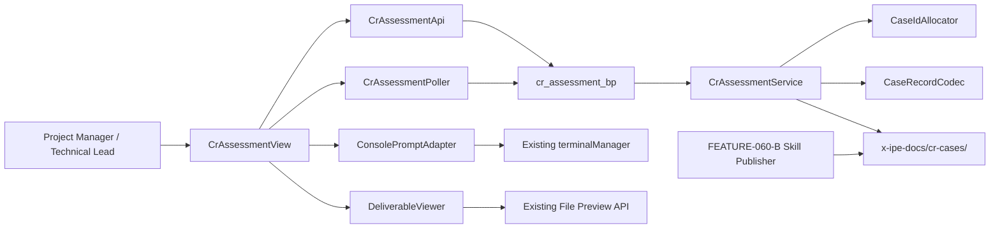
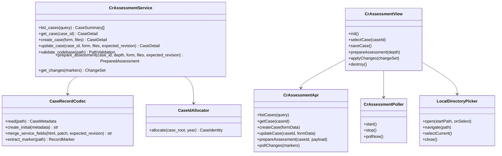
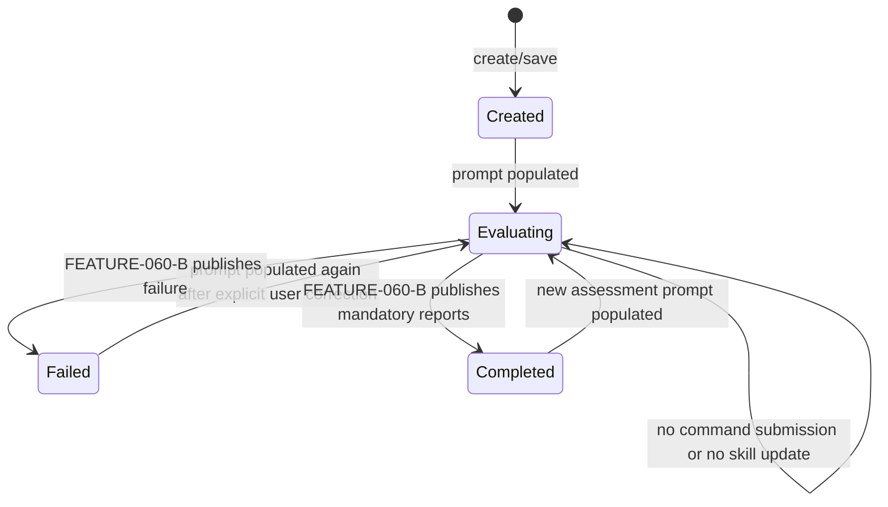
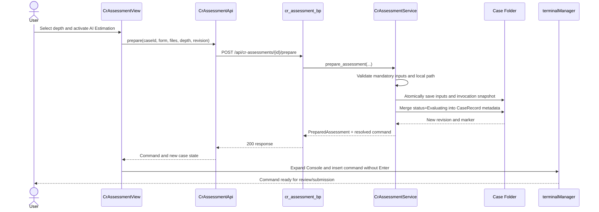

# Technical Design: CR Assessment UI/UX and Case Service

> Feature ID: FEATURE-060-A | Version: v1.1 | Last Updated: 2026-07-22

## Version History

| Version | Date | Description |
|---------|------|-------------|
| v1.0 | 2026-07-21 | Initial full-stack design for case storage, assessment invocation preparation, metadata polling, and report preview |
| v1.1 | 2026-07-22 | Embedded AI Court in the X-IPE right-hand content host with navigation cleanup and standalone-route compatibility |

---

## Part 1: Agent-Facing Summary

> **Purpose:** Implementation reference for agents working on FEATURE-060-A.

### Design Outcome

Implement CR Assessment as a dedicated Flask page backed by a filesystem case service and a focused vanilla JavaScript controller. Reuse X-IPE's existing terminal prompt insertion, folder browser, HTTP polling, toast/status, and deliverable preview capabilities. Do not add a database, WebSocket channel, background worker, or assessment API.

The case folder is the integration boundary with FEATURE-060-B. FEATURE-060-A writes user inputs, original evidence files, an immutable invocation snapshot, and an initial `CaseRecord.html`. FEATURE-060-B independently performs AI reasoning and uses its Python publisher to update the same machine-readable metadata envelope and publish reports.

### Key Components Implemented

| Component | Responsibility | Scope/Impact | Tags |
|-----------|----------------|--------------|------|
| `cr_assessment_bp` | Page and JSON/multipart HTTP endpoints | New Flask Blueprint registered by the application factory | #cr-assessment #flask #api |
| `CrAssessmentService` | Case identity, CRUD, validation, snapshots, metadata merge, summary polling | New filesystem service; no AI behavior | #case-service #filesystem #atomic-write |
| `CaseRecordCodec` | Read and replace the bounded JSON metadata envelope in `CaseRecord.html` | Preserves generated report body and unknown metadata | #case-record #metadata #compatibility |
| `CaseIdAllocator` | Allocate unique immutable `CR-YYYY-NNN` folders with atomic directory creation | Concurrency-safe without a database | #case-id #concurrency #filesystem |
| `CrAssessmentView` | Coordinate case list, form, depth selection, polling, report navigation, and accessibility | New standalone ES6 browser module | #frontend #state #accessibility |
| `CrAssessmentApi` | Typed-by-contract fetch/multipart adapter | Isolates HTTP/error handling from DOM logic | #frontend #api-client #fetch |
| `ConsolePromptAdapter` | Insert an `evaluate-cr-effort` command without Enter | Thin adapter over existing `terminalManager` methods | #console #prompt #reuse |
| `CrAssessmentPoller` | Five-second summary-marker polling with lifecycle cleanup | Reuses the active X-IPE polling convention | #polling #refresh #status |
| `LocalDirectoryPicker` | Browse readable local directories and return an absolute codebase path | New narrow modal following existing X-IPE accessibility patterns | #filesystem #folder-picker #accessibility |
| `cr-assessment.html` | Semantic page shell and initial DOM structure | Extends `base.html`; derived from current mockup | #html #jinja #ui |
| `cr-assessment.css` | Mockup-faithful, responsive, accessible styling | Isolated feature stylesheet using X-IPE tokens where available | #css #responsive #wcag |
| CR assessment prompt config | Add `cr-assessment.prompts[].id = evaluate-cr-effort` | Resource template and project config compatibility | #config #copilot-prompt #skill-invocation |

### Scope and Boundaries

**In scope:** case CRUD, immutable ID, safe evidence storage, local-path validation, immutable snapshots, `Evaluating` transition, Console prompt insertion, five-second polling, report/history presentation, responsive/accessibility behavior, and preservation of skill-owned metadata.

**Out of scope:** AI reasoning, benchmark logic, report-template rendering, command submission, subprocess monitoring, automatic timeout/retry/cancel, WebSocket notifications, remote Git operations, report editing, and knowledge-graph writes.

### Dependencies

| Dependency | Source | Design Link | Usage Description |
|------------|--------|-------------|-------------------|
| `ContentRefreshManager` polling convention | FEATURE-004 | [technical design](x-ipe-docs/requirements/EPIC-004/FEATURE-004-A/technical-design.md) | Follow five-second HTTP polling, change detection, scroll preservation, and non-fatal poll failures |
| `FilePreviewRenderer` / Content Viewer | FEATURE-002 | [technical design](x-ipe-docs/requirements/EPIC-002/FEATURE-002-A/technical-design.md) | Render local HTML report paths through the existing preview safety boundary |
| `DeliverableViewer` | EPIC-043 / existing implementation | [source](src/x_ipe/static/js/features/deliverable-viewer.js) | Open current and historical reports without creating a second preview stack |
| `terminalManager` | FEATURE-005 / FEATURE-038 | [technical design](x-ipe-docs/requirements/EPIC-005/FEATURE-005-A/technical-design.md) | Insert the resolved command into an idle/new Console session without Enter |
| `copilot-prompt.json` | X-IPE configuration | [resource](src/x_ipe/resources/config/copilot-prompt.json) | Define localized label and command with case-folder/depth placeholders |
| FEATURE-060-B | EPIC-060 | [feature breakdown](x-ipe-docs/requirements/requirement-details-part-26.md#feature-060-b-ai-change-request-assessment-skill) | Consume snapshots and publish reports/status through the metadata envelope |
| Current UI mockup | FEATURE-060-A | [mockup](x-ipe-docs/requirements/EPIC-060/FEATURE-060-A/mockups/cr-assessment-view-v1.html) | Source of truth for layout, hierarchy, controls, and responsive visual behavior |

### Major Flow

1. Page loads → API returns case summaries → view renders the mockup-derived rail and selected case.
2. User creates or edits a case → service validates fields/files → atomic persistence updates only service-owned metadata.
3. User chooses depth and activates AI Estimation → UI submits current values → service validates, saves, creates snapshot, and changes status to `Evaluating` in one logical operation.
4. API returns resolved command → UI expands the Console and inserts the command without Enter → user decides whether to submit it.
5. Five-second poll compares case summary markers → only changed summaries/details refresh → toast/status announces external changes.
6. FEATURE-060-B updates `CaseRecord.html` and report files → next poll exposes `Completed`/`Failed`, latest links, and version history.

### Usage Example

```javascript
const result = await crAssessmentApi.prepareAssessment('CR-2026-014', {
    depth: 'standard',
    expectedRevision: 7,
    form: currentFormData,
});

// The API has already saved, snapshotted, and set status to Evaluating.
consolePromptAdapter.insertWithoutEnter(result.command);
```

```text
evaluate change request effort for x-ipe-docs/cr-cases/CR-2026-014 with evaluate-change-request-efforts skill --analysis-depth standard
```

### Tool Capability Summary

| Enabled Tool Skill | Applicable Built-In Practice | Design Use |
|--------------------|------------------------------|------------|
| Python implementation | Existing Flask conventions, type hints, focused services, pytest | Routes/services and integration tests |
| HTML5 implementation | Semantic markup, ARIA, keyboard behavior, responsive CSS, mockup fidelity | Page template and browser module |
| General implementation | Learn existing conventions before implementation | Fallback only; no new stack is required |
| TypeScript, Java, MCP implementation | Available but not applicable to this feature | No TypeScript build, Java module, or MCP server is introduced |

---

## Part 2: Implementation Guide

### 1. Implementation Type and Stack

- **Program type:** `fullstack`
- **Tech stack:** Python 3, Flask Blueprints, Jinja2, vanilla JavaScript ES6, HTML5/CSS3, Bootstrap Icons, pytest, existing X-IPE browser test conventions
- **Persistence:** Local filesystem only
- **Notification:** Five-second HTTP polling only
- **Preview:** Existing `DeliverableViewer` / `FilePreviewRenderer`

No new runtime dependency is required. The design uses standard-library filesystem/JSON operations plus the Flask/Werkzeug stack already installed.

### 2. Target File Layout

```text
src/x_ipe/
├── app.py                                      # register Blueprint and service
├── routes/
│   └── cr_assessment_routes.py                 # page + HTTP contracts
├── services/
│   ├── cr_assessment_service.py                # use cases and persistence orchestration
│   └── case_record_codec.py                    # bounded metadata envelope codec
├── templates/
│   └── cr-assessment.html                      # mockup-derived semantic shell
├── static/css/
│   └── cr-assessment.css                       # isolated responsive styling
└── static/js/features/
    ├── cr-assessment-api.js                    # fetch and multipart adapter
    ├── cr-assessment.js                        # view/state/poller integration
    └── local-directory-picker.js               # server-backed directory-only modal

src/x_ipe/resources/config/copilot-prompt.json  # packaged prompt entry
x-ipe-docs/config/copilot-prompt.json            # active project prompt entry when present
tests/
├── test_cr_assessment_service.py
├── test_cr_assessment_routes.py
└── test_cr_assessment_ui.py
```

Splitting the codec and API client keeps new modules focused and avoids adding large blocks to existing files already near or above the 800-line threshold.

### 3. Component Architecture





### 4. Case Folder Contract

```text
x-ipe-docs/cr-cases/CR-2026-014/
├── CaseRecord.html
├── inputs/
│   ├── cr-description/<original-filename>
│   ├── vendor-estimate/<original-filename>
│   └── supporting/<stored-safe-name>
├── snapshots/
│   └── invocation-v1.json
├── EffortEstimation_AI_v1.html                 # FEATURE-060-B
└── SuggestedTechnicalDesign_AI_v1.html         # FEATURE-060-B
```

Rules:

- Folder name is the immutable generated case ID; Case Name never participates in path construction.
- Original display filenames are retained in metadata. Stored names use `secure_filename`; duplicates receive a deterministic suffix rather than overwrite.
- All resolved write/read targets must remain descendants of the configured case root.
- Existing report files and unknown metadata are never removed during case-service updates.
- Snapshot files are append-only and use monotonically increasing invocation versions.

### 5. CaseRecord Metadata Envelope

`CaseRecord.html` contains a replaceable, machine-readable envelope bounded by stable markers:

```html
<!-- CR_CASE_METADATA_START -->
<script id="cr-case-metadata" type="application/json">
{
  "schema_version": "1.0",
  "record_revision": 8,
  "case": {
    "id": "CR-2026-014",
    "name": "Customer Portal SSO Upgrade",
    "status": "Evaluating",
    "review_state": "Not Reviewed",
    "created_at": "2026-07-21T10:00:00Z",
    "updated_at": "2026-07-21T10:30:00Z"
  },
  "inputs": {
    "cr_description": {"kind": "text", "text": "..."},
    "codebase_path": "/workspace/customer-portal",
    "supporting_documents": [],
    "vendor_estimate": {"path": "inputs/vendor-estimate/vendor.xlsx"},
    "comments": "..."
  },
  "invocation": {
    "latest_snapshot": "snapshots/invocation-v1.json",
    "analysis_depth": "standard",
    "prompt_populated_at": "2026-07-21T10:30:00Z"
  },
  "reports": {
    "latest": {},
    "history": []
  }
}
</script>
<!-- CR_CASE_METADATA_END -->
```

#### Ownership and Merge Rules

| Metadata Area | Primary Writer | FEATURE-060-A Behavior |
|---------------|----------------|------------------------|
| `case.id`, `created_at` | FEATURE-060-A | Immutable after creation |
| `case.name`, input metadata, review state | FEATURE-060-A | Update from validated form |
| `case.status` | Both | A writes Created/Evaluating; B writes Completed/Failed |
| `invocation` | FEATURE-060-A | Append snapshot reference and selected depth |
| `reports`, benchmark/skill/template/model versions | FEATURE-060-B | Preserve losslessly and expose read-only |
| Unknown fields | Future writers | Preserve losslessly |

`CaseRecordCodec` must parse only the bounded JSON block, validate required structure, merge the latest document rather than a stale in-memory copy, increment `record_revision`, serialize `<` as `\u003c`, write a temporary sibling file, flush/sync, and replace the target atomically. The surrounding skill-rendered HTML body remains unchanged.

For a new case, the codec creates a minimal accessible initial HTML shell containing the envelope and a “No assessment generated” state. This shell is not the skill's final report template; FEATURE-060-B replaces the presentation using its versioned template while retaining the same envelope contract.

### 6. Immutable Snapshot Contract

```json
{
  "schema_version": "1.0",
  "snapshot_id": "CR-2026-014/invocation-v1",
  "created_at": "2026-07-21T10:30:00Z",
  "case_id": "CR-2026-014",
  "case_record_revision": 8,
  "analysis_depth": "standard",
  "codebase_path": "/workspace/customer-portal",
  "inputs": {
    "cr_description": {"kind": "text", "value": "..."},
    "comments": "...",
    "files": [
      {
        "role": "vendor_estimate",
        "path": "inputs/vendor-estimate/vendor.xlsx",
        "original_name": "vendor.xlsx",
        "sha256": "..."
      }
    ]
  }
}
```

Snapshot creation sequence:

1. Validate current form and local path.
2. Persist any new evidence files to temporary names and compute SHA-256.
3. Build the next snapshot from the newly saved form state and evidence references.
4. Atomically publish evidence and snapshot.
5. Merge `Evaluating`, depth, snapshot path, and `prompt_populated_at` into the latest metadata envelope.
6. Return the command only after all previous steps succeed.

If any step fails, remove unreferenced temporary files, retain the prior valid case record, and do not populate the Console.

### 7. Lifecycle State Model



FEATURE-060-A has no clock-based transition. A case may remain `Evaluating` indefinitely by confirmed product decision.

### 8. HTTP API Contracts

All responses use `{ "success": boolean, "data": ..., "error": {"code": ..., "message": ...} }`. Error messages are non-sensitive. The local X-IPE app's existing access boundary applies; this feature adds no role model.

#### `GET /cr-assessment`

Render `cr-assessment.html`.

#### `GET /api/cr-assessments?query={text}`

Return newest-updated-first summaries. Optional query matches ID or Case Name case-insensitively.

```json
{
  "success": true,
  "data": {
    "cases": [
      {
        "id": "CR-2026-014",
        "name": "Customer Portal SSO Upgrade",
        "status": "Completed",
        "updated_at": "2026-07-21T10:40:00Z",
        "record_revision": 9,
        "marker": "9:1753094400000000000"
      }
    ]
  }
}
```

#### `POST /api/cr-assessments`

`multipart/form-data`; create a case. Fields: `case_name`, `cr_description_text` or `cr_description_file`, `codebase_path`, `comments`, `vendor_estimate`, and zero or more `supporting_documents`.

- `201`: case detail
- `400 INPUT_INVALID`: field errors
- `413 PAYLOAD_TOO_LARGE`: configured upload limit exceeded
- `500 WRITE_FAILED`: no partial case exposed

#### `GET /api/cr-assessments/{case_id}`

Return editable inputs, readiness, status, reports, history, revision, and marker. Do not return arbitrary source-code content.

#### `PUT /api/cr-assessments/{case_id}`

`multipart/form-data`; update service-owned fields. Requires `expected_revision`.

- `200`: updated detail
- `409 REVISION_CONFLICT`: current detail/marker returned; UI preserves edits and asks user to resolve
- `404 CASE_NOT_FOUND`

#### `POST /api/cr-assessments/validate-path`

```json
{"path": "/workspace/customer-portal"}
```

Return `{valid, reason, normalized_display_path}`. The endpoint confirms local existence/directory/readability; it does not enumerate repository content.

#### `GET /api/cr-assessments/directories?path={absolute-path}`

Return the requested readable directory, its readable child directories, and its parent path. Files and hidden entries are not needed for selection. The initial path is the active X-IPE project root; users may type and validate another absolute local directory. Unreadable paths return `403 PATH_UNREADABLE`; missing or non-directory paths return `400 PATH_INVALID`.

This is a purpose-built directory selector. The existing `FolderBrowserModal` is not reused because it browses workflow deliverables inside project-relative folders and has no arbitrary local-directory selection contract. The new modal follows its dialog, focus, keyboard, breadcrumb, loading, and error conventions without coupling to deliverable APIs.

#### `POST /api/cr-assessments/{case_id}/prepare`

`multipart/form-data` containing the full current form, `depth`, and `expected_revision`.

```json
{
  "success": true,
  "data": {
    "case_id": "CR-2026-014",
    "status": "Evaluating",
    "record_revision": 8,
    "snapshot_path": "x-ipe-docs/cr-cases/CR-2026-014/snapshots/invocation-v1.json",
    "command": "evaluate change request effort for x-ipe-docs/cr-cases/CR-2026-014 with evaluate-change-request-efforts skill --analysis-depth standard"
  }
}
```

The command is resolved from `copilot-prompt.json`; it is not hard-coded in JavaScript. The endpoint does not execute it.

#### `POST /api/cr-assessments/changes`

```json
{
  "markers": {
    "CR-2026-014": "8:1753093800000000000",
    "CR-2026-013": "4:1753091000000000000"
  }
}
```

Return only created, changed, and removed summaries plus a current collection marker. This avoids re-fetching full case bodies every five seconds.

### 9. Assessment Preparation Sequence



### 10. Polling and External Update Flow

```mermaid
sequenceDiagram
    participant P as CrAssessmentPoller
    participant A as CrAssessmentApi
    participant S as CrAssessmentService
    participant F as CaseRecord.html
    participant V as CrAssessmentView

    loop Every 5 seconds while view is active
        P->>A: pollChanges(known markers)
        A->>S: POST /changes
        S->>F: Read stat + bounded metadata for changed markers
        S-->>A: Changed/created/removed summaries
        A-->>P: ChangeSet
        alt No changes
            P-->>V: No-op
        else Selected case changed and form clean
            P->>A: getCase(selectedId)
            A-->>V: Fresh detail
            V->>V: Preserve slide/scroll/focus; update metadata
            V->>V: Announce status toast
        else Selected case changed and form dirty
            P-->>V: Update non-conflicting status/report fields
            V->>V: Preserve inputs and show conflict warning
        end
    end
```

Poller behavior:

- Start after initial page data loads.
- Use one in-flight request at a time; skip a tick if the previous poll is pending.
- Stop on `destroy()` and while the document is hidden; perform an immediate poll when visible again.
- Treat network/parser failures as non-fatal and try again at the next interval.
- Never infer Failed or timeout from polling duration.

### 11. Frontend State Model

```javascript
{
  summaries: [],
  selectedCaseId: null,
  selectedCase: null,
  formDraft: {},
  dirtyFields: new Set(),
  selectedDepth: 'standard',
  activeTab: 'information',
  reportSlide: 0,
  markers: {},
  loading: { list: false, detail: false, save: false, prepare: false },
  errors: { list: null, detail: null, form: {}, operation: null }
}
```

Keep state local to `CrAssessmentView`; do not introduce a global state library. DOM rendering is sectional: rail, header/status, form/readiness, and reports update independently.

#### Dirty-Field Merge

When polling detects an external update:

1. Always accept server-owned report metadata and lifecycle status.
2. For each editable field, accept server value only when that field is not dirty.
3. If server revision changed while any field is dirty, show a conflict banner with Save/Discard actions.
4. PUT/prepare uses `expected_revision`; a 409 retains the draft and surfaces the same resolution path.

### 12. Mockup-to-Component Mapping

The current [CR Assessment View v1](x-ipe-docs/requirements/EPIC-060/FEATURE-060-A/mockups/cr-assessment-view-v1.html) is authoritative for visual hierarchy.

| Mockup Element | Implementation Component | Required Behavior |
|----------------|--------------------------|-------------------|
| X-IPE shell and content host | `ProjectSidebar` + `#content-body` | CR Assessment submenu activation fetches the view, extracts `#cr-assessment-app`, and mounts it into the existing right-hand content area without page navigation |
| Dark top bar and product identity | `.cr-assessment__topbar` | Preserve title/mode hierarchy on the standalone compatibility route; omit the duplicate top bar when embedded in X-IPE page chrome |
| Left case rail | `CaseRail` section in `CrAssessmentView` | Count, search, statuses, selection, empty/no-results, New Case |
| Case heading and number tile | `CaseHeader` | Same selected case name/ID and lifecycle context |
| Information / AI Verdict tabs | `CaseTabs` | ARIA tablist/tab/tabpanel with arrow/Home/End/Enter/Space behavior |
| Two-column information layout | `CaseForm` + `ReadinessCard` | Desktop relationship; collapse below tablet width |
| Codebase path + Browse | `CodebaseField` + `LocalDirectoryPicker` | Navigate readable directories, select current path, validate, restore focus |
| Upload zones and file chips | `EvidenceFields` | Multiple supporting docs, single Vendor estimate, original filenames |
| Readiness checks | `ReadinessCard` | CR brief, Codebase, Vendor Estimate; textual and visual state |
| AI Estimation depth menu | `DepthSelector` | Standard default; Quick/Standard/Deep descriptions; keyboard dismissal |
| Report toolbar and slides | `CaseReportView` | Dot/previous/next/arrow navigation, preserved current slide |
| Expandable module rows | Disclosure controls in preview shell | `aria-expanded`, Enter/Space, visible details |
| Toast | Existing toast/status convention | Save and externally detected changes; live-region announcement |

CSS requirements:

- Scope selectors under `.cr-assessment` to avoid leaking mockup styles.
- Load CR Assessment assets from the main `index.html` shell; use `.cr-assessment--embedded` to remove content padding and size the workspace to its host.
- On navigation away, call `CrAssessmentView.destroy()` before replacing content so polling and document-level listeners are released.
- Reuse existing X-IPE base tokens where equivalent; define feature tokens only for the mockup's slate/emerald treatment.
- Desktop: rail + main workspace; information form + sticky readiness card.
- Tablet: narrower rail and single-column information content without horizontal page scroll.
- Below 768 CSS pixels: one primary pane at a time with an accessible case-list/detail switch.
- Visible focus, non-color status cues, reduced-motion support, and 24-by-24 CSS pixel minimum compact targets.

### 13. Console Prompt Integration

Add the same entry to the packaged resource and active project config where applicable:

```json
{
  "cr-assessment": {
    "prompts": [
      {
        "id": "evaluate-cr-effort",
        "icon": "bi-scale",
        "prompt-details": [
          {
            "language": "en",
            "label": "AI Estimation",
            "command": "evaluate change request effort for <case-folder> with evaluate-change-request-efforts skill --analysis-depth <analysis-depth>"
          }
        ]
      }
    ]
  }
}
```

`CrAssessmentService` resolves only the two allowlisted placeholders. `ConsolePromptAdapter` follows the established action-modal dispatch pattern:

1. Expand the terminal panel if collapsed.
2. Find an idle session or create one.
3. Switch/focus that session.
4. Call `sendCopilotPromptCommandNoEnter(command)`.
5. Do not claim workflow action state and do not append workflow flags for this standalone case flow.

### 14. Security and Failure Handling

| Risk/Failure | Design Response |
|--------------|-----------------|
| Path traversal in case ID or upload name | Strict case-ID regex, canonical descendant check, `secure_filename`, server-generated stored paths |
| Oversized multipart upload | Configure/request-limit payload and return 413; never start partial publication |
| HTML/script content in metadata | JSON serialization, `<` escaping, text-only DOM assignment, sandboxed report preview |
| Symlink escape under case root | Resolve parent/target and reject any path whose canonical path leaves the configured root |
| Concurrent service and skill writes | Revision check, re-read latest envelope, ownership-aware merge, atomic replace |
| Partial evidence/snapshot write | Temporary sibling files/directories and publish-after-validation cleanup |
| Malformed CaseRecord metadata | Return last-known UI state/error; never rewrite a document whose envelope cannot validate |
| Missing latest report | Mark only that link unavailable; preserve history and other valid links |
| Polling failure | Non-blocking degraded indicator; retry next tick; no lifecycle mutation |
| Prompt not submitted | Remain Evaluating indefinitely per BR-060-A-07/08 |

### 15. Testing Strategy

#### Python Unit Tests

- `CaseIdAllocator`: year sequence, duplicate directories, concurrent allocation, invalid root.
- `CaseRecordCodec`: initial document, envelope parsing, unknown-field preservation, revision conflict, `<` escaping, malformed envelope, atomic replace failure.
- Path validation: valid local directory, missing path, file path, unreadable path, remote URL, symlink escape.
- File storage: original filename metadata, safe stored name, duplicate suffix, hash, traversal rejection.
- Snapshot: version increment, immutability, hash/reference correctness, rollback on failure.

#### Flask Route Tests

- List/search/empty behavior and newest-first ordering.
- Multipart create/update and upload limit errors.
- `expected_revision` 409 response.
- Prepare happy path for all depths and failure before prompt return.
- Change-marker response with created/changed/removed cases.
- Missing/malformed case handling and non-sensitive errors.

#### Browser/DOM Tests

- Mockup component presence and breakpoint classes.
- Case selection, search, empty/no-results/loading/error states.
- Dirty-form save/discard guard and poll merge.
- Tab semantics/keyboard operation, depth menu, default Standard.
- Console insertion uses no-Enter path and only after successful prepare.
- Poller one-in-flight rule, five-second interval, visibility pause/resume, destroy cleanup.
- Report slide dots/buttons/arrows, input-caret exception, disclosures, missing report state.
- Focus visibility, live-region status, labels, and target sizes.

### 16. Acceptance-Criteria Traceability

| Specification AC Group | Primary Design Coverage | Test Layer |
|------------------------|-------------------------|------------|
| AC-060-A-01 Case Identity and Creation | CaseIdAllocator, create endpoint, folder contract | Unit + Integration + UI |
| AC-060-A-02 Input Persistence | CrAssessmentService, codec merge, evidence storage | Integration + UI |
| AC-060-A-03 Input Validation | validate-path endpoint, readiness state | Unit + Integration + UI |
| AC-060-A-04 Depth and Prompt Population | prepare endpoint, snapshot, ConsolePromptAdapter | Integration + UI |
| AC-060-A-05 Case List and Selection | list endpoint, CaseRail, local state | API + UI |
| AC-060-A-06 Polling and Notifications | changes endpoint, CrAssessmentPoller, dirty merge | Unit + Integration + UI |
| AC-060-A-07 Report Preview and History | metadata report contract, DeliverableViewer, CaseReportView | Integration + UI |
| AC-060-A-08 Mockup Fidelity and Responsive Layout | template/component mapping and scoped CSS | UI |
| AC-060-A-09 Accessibility | semantic template, tab/disclosure/focus/live-region behavior | UI |

### 17. Ordered Implementation Plan

1. **Case contract and codec:** Implement metadata dataclasses/validation, bounded envelope read/write, atomic replacement, and tests.
2. **Filesystem service:** Implement ID allocation, case CRUD, path validation, upload storage, snapshots, change markers, and tests.
3. **HTTP layer:** Add Blueprint page/API routes, standardized errors, multipart limits, and route tests; register in the app factory.
4. **Prompt configuration:** Add localized `evaluate-cr-effort` entry and placeholder resolution tests.
5. **Page structure:** Translate the current mockup into semantic Jinja markup and isolated responsive CSS.
6. **Frontend behavior:** Implement API adapter, view state, form/readiness, dirty guards, depth menu, Console insertion, report navigation, and accessibility.
7. **Polling integration:** Add five-second marker polling, dirty-field merge, visibility lifecycle, and status notifications.
8. **Preview integration:** Reuse DeliverableViewer/FilePreviewRenderer for latest/history paths and failure isolation.
9. **Verification:** Run Python, route, and browser/DOM tests; compare desktop/tablet/mobile renderings with the current mockup.

### 18. Design Principles Check

- **KISS:** Filesystem is the required persistence; no database, queue, worker, or new realtime transport.
- **YAGNI:** No automatic recovery, remote Git, role platform, report editor, or skill monitor.
- **DRY:** Reuse existing terminal, prompt config, folder browser, polling convention, toast, and deliverable preview.
- **SOLID:** Codec, service, routes, API adapter, view, and poller have narrow boundaries.
- **800-line rule:** New behavior lives in focused modules; no large addition to `terminal.js`, `workplace.js`, or `ideas_service.py`.

---

## Design Change Log

| Date | Phase | Change Summary |
|------|-------|----------------|
| 2026-07-21 | Technical Design | Created the initial full-stack design using a stable CaseRecord metadata envelope, atomic filesystem persistence, immutable snapshots, existing Console insertion, five-second HTTP polling, DeliverableViewer reuse, and mockup-derived accessible UI components. |
| 2026-07-22 | Code Implementation | Changed Workplace navigation from a standalone redirect to an inline `#content-body` mount; added embedded sizing and explicit view cleanup on navigation. |
