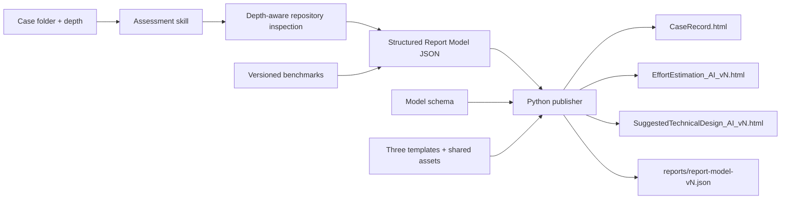
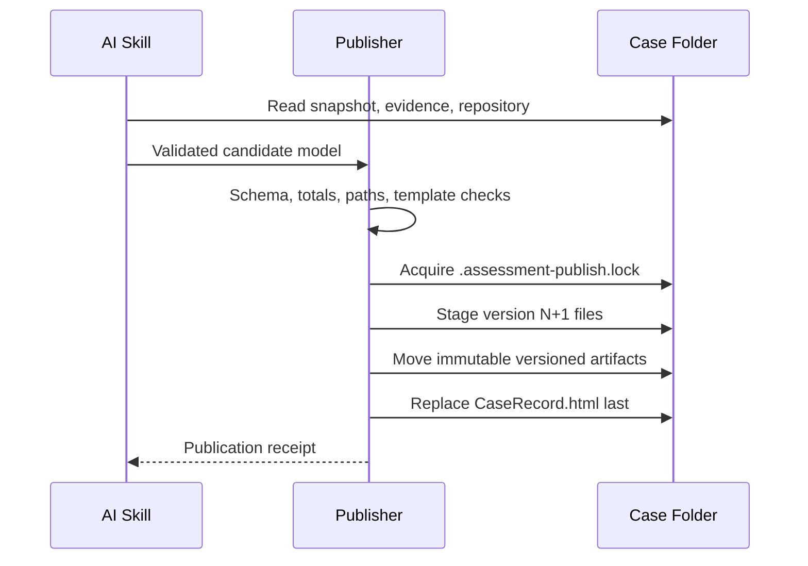
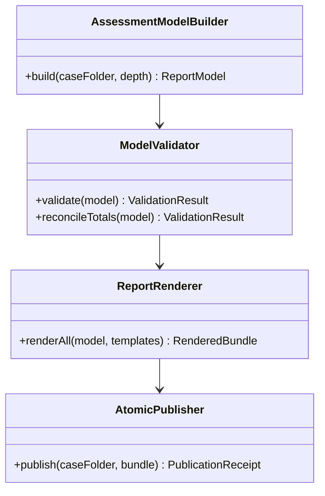

# Technical Design: AI Change Request Assessment Skill

> Feature ID: FEATURE-060-B | Version: v1.0 | Last Updated: 2026-07-22

## Version History

| Version | Date | Description |
|---|---|---|
| v1.0 | 2026-07-22 | Initial design for depth-aware assessment, structured reports, offline templates, and atomic publication |

## Part 1: Agent-Facing Summary

### Design Outcome

Create `x-ipe-task-based-evaluate-change-request-efforts` through the mandatory candidate-first `x-ipe-meta-skill-creator` workflow. The skill uses AI reasoning to inspect a local repository and create one schema-valid report model. A standard-library Python publisher—not the reasoning prompt—performs deterministic calculation checks, safe template rendering, version reservation, file publication, and CaseRecord metadata updates.

### Key Components Implemented

| Component | Responsibility | Scope/Impact | Tags |
|---|---|---|---|
| `SKILL.md` | Validate inputs and orchestrate depth-aware evidence, estimation, design, and publication | Task-based skill under 500 lines | #skill #assessment #workflow |
| `assessment-method.md` | Define evidence precedence, depth coverage, confidence, benchmark, AI-factor, and comparison rules | Stable reasoning reference | #method #effort #confidence |
| `benchmarks-v1.json` | Versioned fallback benchmark ranges and applicability metadata | Auditable data, never overrides repository evidence | #benchmark #versioned |
| `report-model-v1.schema.json` | Contract between AI reasoning and deterministic publication | One validated source for all reports | #schema #report-model |
| `publish_reports.py` | Validate, reconcile, render, reserve versions, publish, and update CaseRecord | Python standard library; no AI decisions | #publisher #atomic #python |
| Three HTML templates | Render CaseRecord, effort evidence, and Vendor design from model data | Derived from approved mockups | #html #template #offline |
| `report.css` | Shared responsive, accessible, printable theme | Avoids template style duplication | #css #wcag #print |
| `report.js` | Disclosures, navigation, Mermaid initialization, local fallback | Shared offline browser behavior | #javascript #mermaid #a11y |
| `mermaid.esm.min.mjs` | Pinned Mermaid v11 runtime | Local strict rendering; no CDN | #mermaid #offline #security |

### Scope and Boundaries

The skill reads the case and assessed repository, writes only within the case folder, and publishes reports. It does not edit source code, invoke an assessment API, fetch live benchmarks, write knowledge, submit Console commands, or make commercial decisions.

### Dependencies

| Dependency | Source | Design Link | Usage Description |
|---|---|---|---|
| Case folder and metadata envelope | FEATURE-060-A | [technical design](x-ipe-docs/requirements/EPIC-060/FEATURE-060-A/technical-design.md) | Supplies immutable snapshot and publisher integration contract |
| Approved report mockups | EPIC-060 | [specification](x-ipe-docs/requirements/EPIC-060/FEATURE-060-B/specification.md) | Visual and information-architecture baseline |
| Skill creator | X-IPE | [skill](.github/skills/x-ipe-meta-skill-creator/SKILL.md) | Candidate, validation, evaluation, and merge workflow |

### Major Flow

1. Validate case path, depth, snapshot, evidence, and repository.
2. Inspect scope according to depth; label evidence as observed, inferred, or unverified.
3. Produce a schema-valid model using project evidence first and benchmarks as fallback context.
4. Run the publisher; it verifies totals and safety, stages outputs, reserves version `N+1`, and commits metadata last.
5. FEATURE-060-A polling observes Completed or Failed and presents latest/history links.

### Usage Example

```text
evaluate change request effort for x-ipe-docs/cr-cases/CR-2026-014 with evaluate-change-request-efforts skill --analysis-depth deep
```

```bash
python candidate/scripts/publish_reports.py \
  --case-folder x-ipe-docs/cr-cases/CR-2026-014 \
  --model /tmp/CR-2026-014-report-model.json
```

## Part 2: Implementation Guide

### 1. Implementation Type and Stack

- **program_type:** `skills`
- **tech_stack:** X-IPE task-based skill, Python 3 standard library, JSON Schema-compatible validation, HTML5/CSS3, vanilla JavaScript, Mermaid v11 ESM, pytest, Vitest
- Python practices: type hints, focused modules, pytest, atomic filesystem operations.
- HTML practices: semantic structure, progressive enhancement, keyboard access, responsive and printable output.
- TypeScript, Java, and MCP tools are enabled for consultation but are not applicable.

### 2. Candidate-First Layout

```text
x-ipe-docs/skill-meta/x-ipe-task-based-evaluate-change-request-efforts/
├── skill-meta.md
├── test-cases.yaml
├── evaluation-report.yaml
└── candidate/
    ├── SKILL.md
    ├── references/
    │   ├── assessment-method.md
    │   ├── benchmarks-v1.json
    │   └── report-model-v1.schema.json
    ├── scripts/
    │   └── publish_reports.py
    ├── templates/
    │   ├── case-record-template.html
    │   ├── effort-estimation-template.html
    │   └── suggested-technical-design-template.html
    └── assets/
        ├── report.css
        ├── report.js
        └── mermaid.esm.min.mjs
```

Only after creator validation passes is the complete candidate copied to `.github/skills/x-ipe-task-based-evaluate-change-request-efforts/`.

### 3. Component Flow







### 4. Assessment Algorithm

Depth controls breadth, not report completeness. Quick inspects targets and immediate tests; Standard adds dependencies, primary integrations, data impact, and regression scope; Deep traverses the reachable baseline and systemic risks. Unreachable scope is recorded, never silently downgraded.

For each module the model records work packages, observed evidence, assumptions, exclusions, low/high raw range, benchmark context, reuse adjustment, evidence-gated AI adjustment, contingency, final range, and confidence. Totals are sums of included final module ranges. The publisher rejects inconsistent arithmetic. Vendor comparison uses four outcomes: overestimate, aligned, underestimate, or insufficient evidence.

### 5. Report Model Contract

Top-level required objects are `schema`, `provenance`, `case`, `coverage`, `estimate`, `design`, `diagrams`, and `publication`. Provenance includes snapshot hash plus skill, model-schema, benchmark, template, and Mermaid versions. Evidence entries use project-relative path, observation, classification, and optional line/location; source bodies and secrets are excluded.

The publisher retains the canonical model at `reports/report-model-vN.json`. Template rendering uses escaped text and explicit component builders; arbitrary model HTML is forbidden. Mermaid source is emitted as text inside `<pre class="mermaid">`.

### 6. Safe Publication Transaction

1. Canonicalize paths and acquire an exclusive case-local lock.
2. Re-read CaseRecord and calculate the next version from metadata plus existing immutable files.
3. Validate schema, required language consistency, arithmetic, report links, diagram types, and template compatibility.
4. Render all files into a same-filesystem staging directory and validate their metadata markers.
5. Move immutable `vN` model/effort/design files into place using `os.replace`.
6. Render and replace `CaseRecord.html` last; this is the visibility commit point.
7. On failure, remove staging, leave previous latest metadata unchanged, and safely record Failed where possible. Unreferenced new-version files may be cleaned on retry and never become latest.

Concurrency is controlled by the case-local lock plus an exclusive version reservation. No database or background worker is introduced.

### 7. Template and Mockup Mapping

| Mockup area | Template component |
|---|---|
| CaseRecord CIO slides | Semantic slide list, previous/next/dots, report and history links |
| Effort verdict and comparison | Executive verdict cards and non-color numeric comparison tracks |
| Module findings | Native buttons/disclosures with confidence and evidence details |
| Adjustment factors | Benchmark, reuse, AI factor, contingency, and provenance table |
| Design adoption summary | Decision, reuse boundary, component impact, and savings evidence |
| Design implementation guide | Contracts, data model, sequences, packages, tests, rollout/rollback, risks, handoff checklist |

Shared assets are copied into each case report bundle under `assets/` so relative links work offline. JavaScript enhances navigation and disclosures; core report text remains readable without it. Mermaid initializes with `startOnLoad:false` and `securityLevel:"strict"`; each diagram is rendered independently so one failure exposes local source/error only.

### 8. Publisher Interface and Exit Codes

```text
publish_reports.py --case-folder PATH --model PATH [--dry-run]
```

| Exit | Meaning |
|---:|---|
| 0 | Complete publication committed |
| 2 | Invalid arguments or unsafe path |
| 3 | Case/snapshot contract invalid |
| 4 | Report model or arithmetic invalid |
| 5 | Template/asset incompatibility |
| 6 | Lock, version, or filesystem publication failure |

Success prints a JSON receipt containing case ID, version, model path, report paths, and CaseRecord revision. Errors print a non-sensitive JSON error to stderr.

### 9. Testing Strategy

- **Unit:** depth rules, evidence precedence, AI-factor gating, confidence, symmetric comparison, arithmetic, language selection, escaping, and schema rejection.
- **Integration:** fixture case assessment, lock contention, concurrent version claims, injected write failures, metadata conflicts, history preservation, and re-rendering from retained JSON.
- **UI/Vitest:** disclosures, slide navigation, keyboard state, Mermaid per-diagram fallback, optional blocks, and no-JavaScript readability.
- **Golden structure tests:** templates match required mockup sections without asserting illustrative data or fragile pixel snapshots.
- **Offline test:** open copied report bundle with network disabled and verify text, styling, links, print rules, and Mermaid asset resolution.

### 10. Implementation Order

1. Run `x-ipe-meta-skill-creator`; create meta and candidate structure from task-based templates.
2. Define examples, method, benchmark v1, schema v1, and fixture models.
3. Implement publisher validation and failure-injection tests before templates.
4. Derive three templates and shared assets from approved mockups.
5. Write the skill procedure that generates only model data and invokes the publisher.
6. Run creator reflection, test, evaluation, and candidate-to-production merge.
7. Execute one Quick, Standard, and qualified Deep fixture end to end.

### 11. Edge Cases and Handling

| Scenario | Behavior |
|---|---|
| Partial depth coverage | Publish qualified result with gaps and reduced confidence |
| Unsupported/binary evidence | Reference and flag; do not invent interpretation |
| No evidence for AI gain | Apply zero AI reduction |
| Malformed Mermaid | Local fallback; other diagrams/reports remain usable |
| Concurrent publishers | One version reservation succeeds; other retries from fresh state |
| Disk/permission failure | Latest metadata remains on prior valid version |
| CaseRecord revision conflict | Abort commit and retry from a fresh read; never overwrite unknown fields |
| Unknown model fields | Preserve when allowed by schema; reject incompatible required versions |

## Design Change Log

| Date | Phase | Change Summary |
|---|---|---|
| 2026-07-22 | Technical Design | Defined candidate-first skill architecture, project-evidence precedence, retained model JSON, evidence-gated AI factors, qualified partial-depth results, offline mockup-derived templates, and metadata-last publication. |
